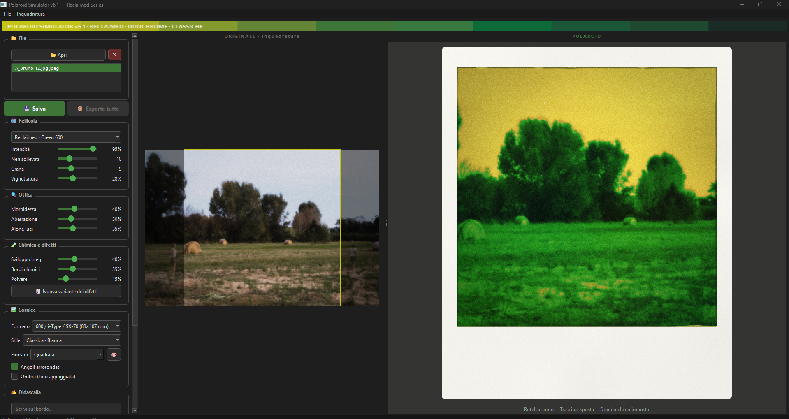
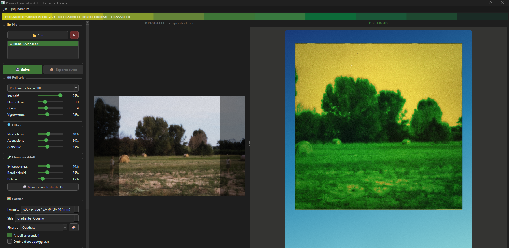
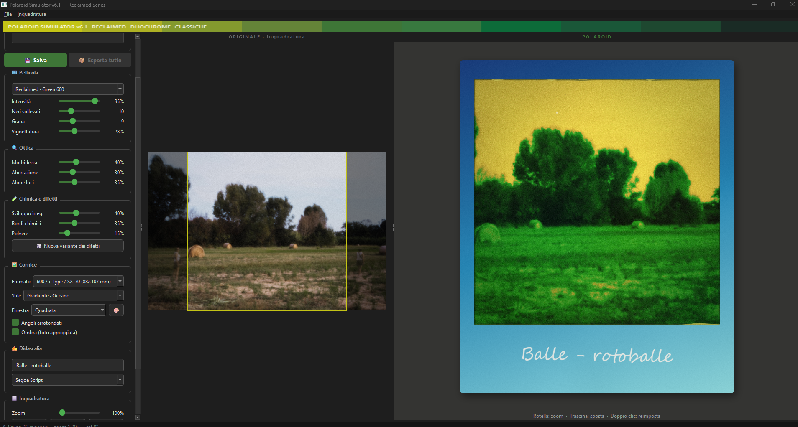

# Polaroid Simulator — Reclaimed Series

**IT** · [EN](#english)

Simulatore desktop di foto Polaroid istantanee, scritto in Python/PyQt6. Le curve colore sono ricavate da scansioni e stampe reali, non da filtri "a occhio": l'obiettivo è un risultato il più vicino possibile a una vera Polaroid.



## Perché esiste

Le pellicole Polaroid oggi sono difficili da trovare: edizioni limitate spesso esaurite, prezzi alti e rincarati sul mercato secondario. L'imprevedibilità della pellicola è bella, ma non a quel costo. Questo programma prova a restituirla in digitale, partendo dai dati.

## Funzioni

- **Pellicole** con curve misurate da materiale reale:
  - *Reclaimed* Green 600 (6237 punti da 2 scansioni, interpolazione PCHIP), Blue 600, Purple 600
  - *Duochrome* Black & Yellow, Black & Green, Black & Blue, Black & Pink
  - *Classiche* Color 600, B&N 600
  - Duotono personalizzato
- **Ottica**: morbidezza della lente in plastica, aberrazione cromatica, alone sulle luci, vignettatura
- **Chimica e difetti**: sviluppo irregolare, bordi chimici, lingue di reagente, polvere, grana legata alla luminanza; pulsante "nuova variante" per rigenerare i difetti
- **Geometria reale**: 600 / i-Type / SX-70 (88×107 mm, finestra 79×79) e Go (53,9×66,6 mm, finestra 47×46)
- **Cornici**: classiche, Color Frame, pastello, metallic, gradienti, finestra rotonda, colore libero o PNG esterno; angoli arrotondati e ombra
- **Didascalia** scritta a mano sul bordo, con scelta del font
- **Inquadratura interattiva**: rotella = zoom, trascina = sposta, doppio clic = reimposta; l'immagine non esce mai dalla finestra
- Esportazione singola o in blocco

| Gradiente Oceano | Con didascalia |
|---|---|
|  |  |

## Installazione

Richiede Python 3.9+.

```bash
pip install -r requirements.txt
python polaroid_green600.py
```

Funziona su Windows e Linux (testato principalmente su Windows).

## Autore

**Dmitrij Musella** — fotografo sperimentale e ricercatore indipendente, Napoli.
ORCID [0009-0004-4105-837X](https://orcid.org/0009-0004-4105-837X)

Polaroid è un marchio di Polaroid B.V. Questo progetto è indipendente e non è affiliato né approvato da Polaroid.

## Licenza

[MIT](LICENSE)

---

## English

Desktop simulator of instant Polaroid photos, written in Python/PyQt6. Colour curves are derived from real scans and prints rather than eyeballed filters, aiming for a result as close as possible to a real Polaroid.

**Why:** Polaroid film is hard to find today — limited editions sell out, prices are high and inflated on the resale market. The film's unpredictability is lovely, but not at that cost.

**Features:** measured film curves (Reclaimed Green/Blue/Purple 600, Duochrome Yellow/Green/Blue/Pink, Color 600, B&W 600, custom duotone); plastic-lens softness, chromatic aberration, highlight halation, vignetting; uneven development, chemical edges, reagent tongues, dust, luminance-linked grain; true 600/i-Type/SX-70 and Go geometry; classic, Color Frame, pastel, metallic, gradient, round-window, custom-colour or external PNG frames; handwritten caption; interactive framing (wheel = zoom, drag = pan, double-click = reset); single and batch export.

**Install:** `pip install -r requirements.txt` then `python polaroid_green600.py` (Python 3.9+, Windows/Linux).

Polaroid is a trademark of Polaroid B.V. This is an independent project, not affiliated with or endorsed by Polaroid.

License: MIT · Author: Dmitrij Musella
